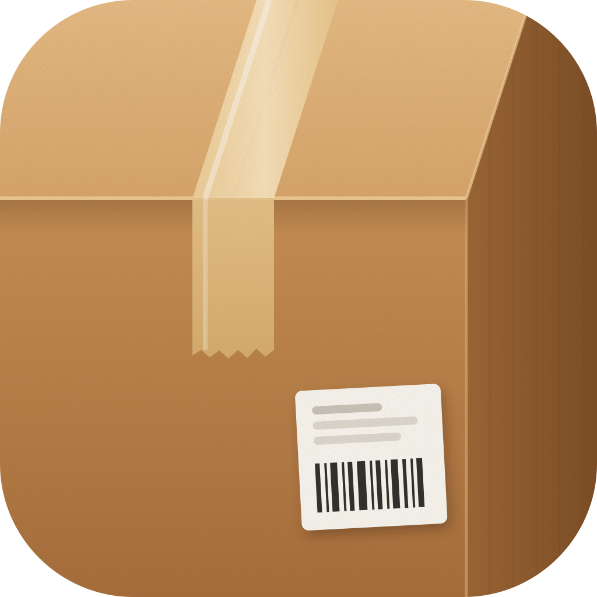

  

Cartons tracks your packages and tells you how many days until each one shows up. Try it at [cartons.jaybulb.com](https://cartons.jaybulb.com).

Paste a UPS tracking number, or the whole link from a shipping email. Cartons reads the status straight from UPS, works out the delivery date and puts a countdown next to the package. There's no account and no server. Your list stays on your phone and syncs through iCloud.

## Features
- A countdown to the delivery day for every package
- Paste a number or a full tracking link; tracking numbers on the clipboard are picked up
- Status, estimated delivery, last scan, service and destination
- Archive for delivered packages
- iCloud sync, a profile, and nothing sent to any server of ours
- A web app at cartons.jaybulb.com, same countdown, list kept in your browser
- `cli/ups.py`, a terminal tracker for when you have UPS API keys

## Run it
```
xcodegen generate && open Cartons.xcodeproj
tests/run.sh               # Swift parser check against real UPS page text
node worker/parse.test.mjs # the web parser, same page text
npx wrangler deploy        # landing, web app and /api/track
```

MIT License, 2026 Joshua Trommel.
